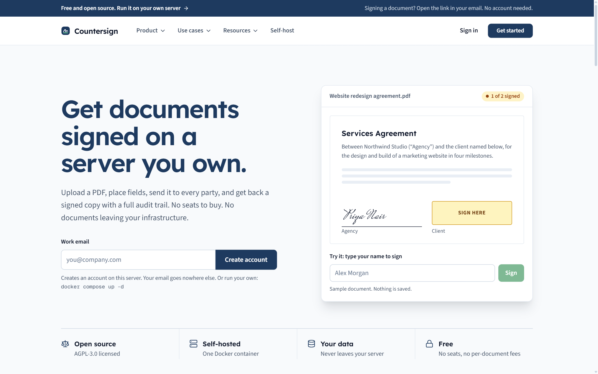
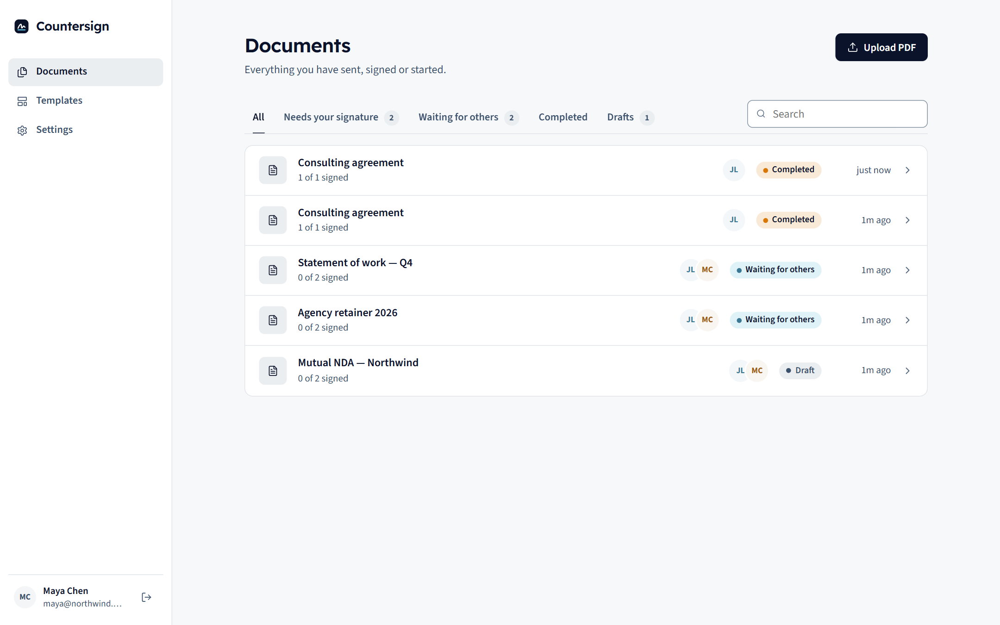
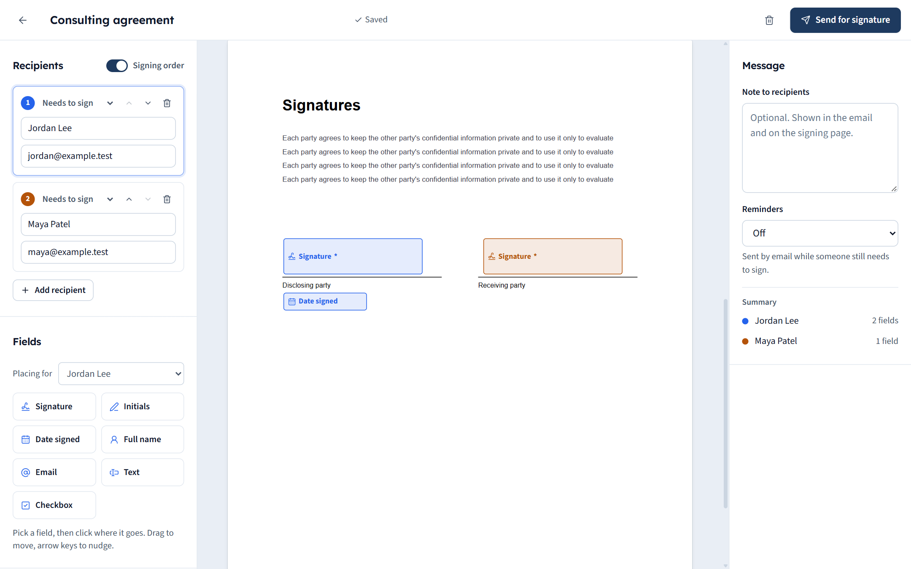
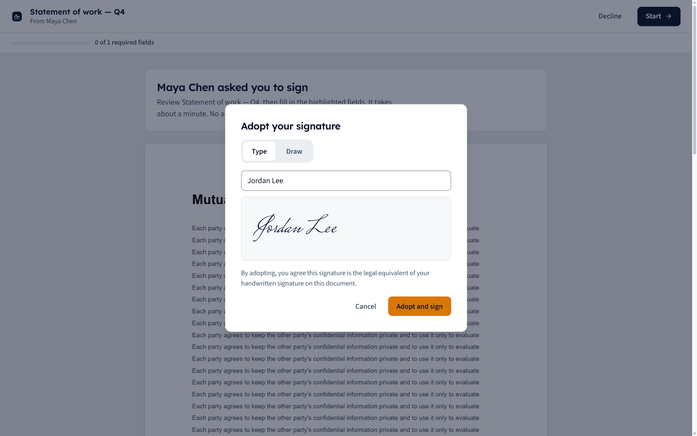
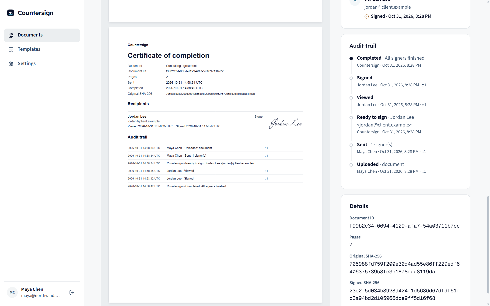
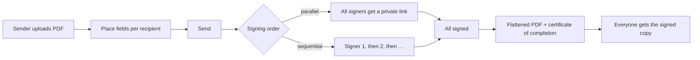

<div align="center">


# Countersign

**Open-source e-signatures you host yourself.**

Upload a PDF, place fields, send it to everyone who needs to sign, and get back a signed PDF with a certificate of completion and a full audit trail.<br>
No pricing. No seats. Your documents never leave your server.

[](LICENSE)


[Quick start](#quick-start) · [Features](#features) · [Configuration](#configuration) · [Security](#security-model) · [Contributing](#contributing)

<br>



</div>

---

## Why Countersign

Most teams only need the core of an e-signature product: send a PDF, collect signatures in the right order, and keep proof of who signed what and when. Countersign gives you exactly that as one small, self-hosted service.

| | |
|---|---|
| **Own the data** | PDFs, signatures and audit logs live in one volume on your server. Nothing is sent to a third party. |
| **One command to run** | A single Docker container with a built-in SQLite database. No database server, queue or object storage. |
| **Free means free** | No plans, no per-envelope limits, no locked features. |
| **Signers need nothing** | Recipients open a private link and sign in the browser on any device. No account, no download. |

## Features

<table>
<tr>
<td width="50%" valign="top">

### Prepare
Upload any PDF and click to place **signature, initials, stamp, date signed, full name, email, company, job title, text, number, checkbox, dropdown and radio** fields. Drag to move, resize from the corner, nudge with the arrow keys. Each recipient gets their own colour.

### Route
Any number of signers, plus people who only receive a copy. Sign **in parallel or in a set order**; the next person is notified the moment the previous one finishes. Add a message and automatic email reminders, set the document to **expire** after a number of days, and optionally require each signer to enter a **one-time code** emailed to them before they can see or sign it. Or **sign it yourself** with no one else involved. Optionally send signers to an https address of your choice when they finish (they click to continue).

### Templates
Save a document with fields placed for roles like *Client* and *Agency*. Reuse it and only type names and emails. **Bulk send** one template to up to 500 people at once (type the rows or import a CSV), or turn on a **public link** so anyone with it can fill in their name and email and sign their own copy (useful for waivers and sign-up forms).

</td>
<td width="50%" valign="top">

### Sign
A guided walkthrough jumps from field to field. Signers **type** a signature in one of five handwriting styles, **draw** it, or **upload** a photo or scan of their own (the background is removed in the browser). They adopt it once and reuse it everywhere. Account holders can save a signature and initials (stored encrypted) and reuse them whenever a signing link is addressed to them. Works with a mouse, trackpad, finger or keyboard, and on small phones.

### Finish
When the last person signs, every field is flattened into the PDF and a **certificate of completion** is appended: signers, timestamps, IP addresses, the original file's SHA-256 and the full audit trail. The finished PDF then gets a **digital seal** (a PKCS#7 signature over the whole file), so PDF readers can show whether it was changed afterwards. Anyone with a copy can check it on the public **/verify** page: the file is fingerprinted (SHA-256) in their browser and never uploaded.

### Manage
A dashboard with *Needs your signature*, *Waiting for others*, *Completed* and *Drafts*. Copy signing links, send reminders, let signers decline with a reason, and void a document at any time. **Contacts** fill in as you send (or import a CSV) and are suggested while you type recipients. Edit the **invite and completion emails** with placeholders such as `{{receiver_name}}` and `{{document_title}}`; the signing button is always added. File documents and templates into **folders**. Connect other systems with personal **API keys** and signed **webhooks**.

</td>
</tr>
</table>

## Screenshots

<table>
<tr>
<td><p align="center"><sub>Documents dashboard</sub></p></td>
<td><p align="center"><sub>Placing fields for each signer</sub></p></td>
</tr>
<tr>
<td><p align="center"><sub>Signer view, no account needed</sub></p></td>
<td><p align="center"><sub>Certificate of completion in the signed PDF</sub></p></td>
</tr>
</table>

## Quick start

### Docker (recommended)

```bash
git clone https://github.com/cre8ive-marketing/Countersign.git
cd Countersign
cp .env.example .env      # set APP_URL; SMTP is optional
docker compose up -d
```

Open `http://localhost:3000` and create the first account. Sign-ups close after that unless `ALLOW_SIGNUP=true`.

All state lives in the `countersign-data` volume (`/data` in the container): `countersign.db` (SQLite) and `files/` (original and signed PDFs, encrypted).

> [!IMPORTANT]
> Every PDF and every signature is encrypted with AES-256. Set your own key before you store real documents: `openssl rand -hex 32` and put the result in `ENCRYPTION_KEY` in `.env`. Without it, Countersign generates `encryption.key` inside the data volume, which keeps backups of the files alone unreadable but does not protect against someone who has the whole volume. **If you lose the key, every document is lost.** Back it up separately from the data.

### Without Docker

Needs **Node.js 22.13 or newer** (it uses the built-in `node:sqlite`).

```bash
npm ci
npm run build
npm start
```

Data goes to `./data` unless `DATA_DIR` is set.

## Configuration

| Variable | Default | What it does |
|---|---|---|
| `APP_URL` | request host | Public URL used in emailed links, reminders, `robots.txt` and `sitemap.xml`. `https://` turns on Secure cookies. Required for automatic reminders. |
| `DATA_DIR` | `./data` (`/data` in Docker) | Where the database and PDFs are stored. |
| `ALLOW_SIGNUP` | `false` | The first account can always sign up. Set `true` to let anyone create an account. |
| `ENCRYPTION_KEY` | generated file in `DATA_DIR` | 32-byte AES-256 key as 64 hex characters or base64. Encrypts every PDF and field value. Back it up; changing or losing it makes existing documents unreadable. |
| `TRUST_PROXY` | `false` | Set `true` behind a reverse proxy so the audit trail, login limits and the /verify limit (60 checks an hour per address) use the client IP from `X-Forwarded-For`. Leave it off when clients connect directly. |
| `TOKEN_TTL_DAYS` | `30` | How long a signing link stays valid. Reminders and a signer's turn coming up extend it. |
| `SESSION_IDLE_MINUTES` `SESSION_MAX_DAYS` | `60`, `7` | Sign-in sessions end after this much inactivity, or this long after sign-in. |
| `LOGIN_MAX_ATTEMPTS` `LOGIN_IP_MAX_ATTEMPTS` | `5`, `50` | Failed sign-ins allowed per account from one address, and per address, within 15 minutes before a 15-minute lock. |
| `SIGNUP_MAX_PER_HOUR` | `10` | Sign-up attempts allowed per address per hour while sign-ups are open. |
| `SMTP_HOST` `SMTP_PORT` `SMTP_SECURE` `SMTP_USER` `SMTP_PASS` `SMTP_FROM` | unset | Email delivery. Without SMTP, senders copy each signing link from the document page. **Set `APP_URL` too:** emails are not sent without it, because links built from the request's host could be forged. |
| `SIGNING_P12_BASE64` `SIGNING_P12_PASSPHRASE` | unset | Your own certificate (PKCS#12, base64) for the digital seal on completed PDFs. Without it, Countersign generates a self-signed one once and stores it encrypted as `signing.p12` in `DATA_DIR`. An invalid or expired certificate stops the server at startup. |
| `WEBHOOK_ALLOW_HTTP` `WEBHOOK_ALLOW_PRIVATE` | `false` | Development and tests only. Allow webhook URLs on plain `http://`, and to private, loopback or link-local addresses. Leave both off in production. |
| `PORT` | `3000` | HTTP port. |

## Operating it

- **HTTPS:** run it behind Caddy, nginx or Traefik, set `APP_URL=https://…` and `TRUST_PROXY=true`, and add HSTS at the proxy. Forwarded headers are ignored unless `TRUST_PROXY=true`. If your proxy rewrites the `Host` header and you leave it off, form submissions are rejected as cross-origin.
- **Backups:** stop the container (or use `sqlite3 .backup`) and copy the whole data volume. The database and `files/` must be backed up together. Back up the encryption key separately; a backup without it cannot be restored.
- **Upgrades:** `git pull && docker compose up -d --build`. The schema is created and extended on start. Existing unencrypted documents are encrypted once on the first start after upgrading.
- **Security logs:** sign-ins, failed sign-ins, lockouts, password changes, expired links and file integrity failures are stored in the database and printed to stdout as JSON lines (`{"security_event": …}`, `{"audit_head": …}`). Ship stdout to your log system; the `audit_head` lines let you detect if recent audit events are later removed from the database.

## API and webhooks

Create a key in **Settings → API keys**. It is shown once; send it as `Authorization: Bearer cs_…`. A key acts as your account on document and folder routes only. It cannot manage keys, webhooks or your account, and it never returns signing links. Each key allows 600 requests an hour.

| Method and path | What it does |
|---|---|
| `GET /api/documents?status=&template=0\|1&folder=&limit=&offset=` | List your documents and templates |
| `POST /api/documents` | Upload a PDF (`Content-Type: application/pdf`; add `x-template: 1` for a template) |
| `GET` `PUT` `DELETE /api/documents/{id}` | Read, edit (drafts) or delete |
| `POST /api/documents/{id}/send` `void` `remind` `copy` `move` | Lifecycle actions (JSON body) |
| `POST /api/documents/{id}/bulk` | Bulk send from a template: JSON `{ "rows": [[{ "name", "email" }, …], …] }` or a CSV body (`name,email` per role). Send an `Idempotency-Key` header so a retry cannot send twice. 10 calls an hour. |
| `GET /api/documents/{id}/file?kind=original\|signed` | Download a PDF |
| `GET` `POST /api/folders`, `PUT` `DELETE /api/folders/{id}` | Folders |

**Webhooks** (Settings → Webhooks) send a JSON `POST` for `document.sent`, `recipient.viewed`, `recipient.signed`, `recipient.declined`, `document.completed`, `document.declined`, `document.voided` and `document.expired`. The body holds ids, title, status and the recipient's name, email and role, never files, field values or links. Deliveries that do not get a 2xx within 10 seconds are retried 6 more times over about 21 hours; redirects are not followed. After 20 deliveries fail every retry, the webhook is turned off and you get an email. Events can arrive out of order; use `createdAt` in the body. Webhook URLs must be `https://` and may not point to private or internal addresses.

Each request carries `Countersign-Signature: t=<unix seconds>,v1=<hex>`, where `v1` is HMAC-SHA256 of `<t>.<raw body>` keyed with the whole `whsec_…` secret shown when you created the webhook. Check it before trusting the body:

```js
import crypto from 'node:crypto';

function verify(rawBody, header, secret, toleranceSec = 300) {
  const { t, v1 } = Object.fromEntries(header.split(',').map((p) => p.split('=')));
  const expected = crypto.createHmac('sha256', secret).update(`${t}.${rawBody}`).digest('hex');
  const fresh = Math.abs(Date.now() / 1000 - Number(t)) <= toleranceSec;
  return fresh && v1?.length === expected.length && crypto.timingSafeEqual(Buffer.from(v1), Buffer.from(expected));
}
```

## How it works



| Layer | Technology |
|---|---|
| App | Next.js (Pages Router), React, plain JavaScript |
| Data | SQLite via Node's built-in `node:sqlite`, PDFs on local disk |
| PDF | `pdf-lib` for stamping and certificates, `pdfjs-dist` for in-browser rendering |
| Email | Optional SMTP through `nodemailer`; hourly reminder job |
| Deploy | One Docker image (Next standalone, non-root) with one data volume |

## Security model

- **Encryption at rest:** every PDF and every field value (signatures, initials, text) is encrypted with AES-256-GCM, bound to its document or field so files can't be swapped. Every download and every stamping run also checks the file against its recorded SHA-256 and refuses a mismatch.
- **Accounts:** passwords (at least 12 characters) are hashed with scrypt. Sessions are opaque `HttpOnly; SameSite=Lax` cookies, `Secure` on https, stored only as hashes, and end after inactivity or a maximum age. Changing your password signs out your other devices, and *Sign out of all devices* ends every session.
- **Sign-in abuse:** failed sign-ins are limited per account and address with temporary locks, and responses take the same time whether or not the account exists.
- **Signing links:** each signer gets an unguessable link, stored only as a hash plus an encrypted copy. Links expire, and voiding or declining a document revokes them. Signers see only their own fields, and only when it is their turn.
- **Email codes (optional per document):** the signer must enter a 6-digit code sent to their address before the page shows the document, its fields or the file. Codes last 10 minutes, allow 5 tries, and are stored only as keyed hashes; a verified browser gets a 12-hour `HttpOnly` cookie for that signer only. A code shows access to the inbox, not who someone is. Needs SMTP and `APP_URL`.
- **Digital seal:** the completed PDF is signed with a certificate so any later change is detectable. A self-signed seal does not identify a person or company, and PDF readers may show its signer as unverified; use your own certificate if that matters.
- **Expiry:** past its expiry date a document can no longer be viewed, signed or declined, and its links are revoked.
- **Requests:** every state-changing request is checked for same origin, and every document read or write checks ownership on the server.
- **API keys:** stored only as keyed hashes, shown once, revocable, rate limited, and refused on account, key and webhook routes. Keys do not expire on their own and are not revoked by signing out; revoke unused keys.
- **Webhooks:** secrets are stored encrypted. Each delivery resolves the host itself and refuses loopback, private, link-local and similar addresses at connect time, so DNS tricks cannot reach internal services.
- **Public links:** anyone with the link can create a copy, so the signer's name and email are only what they typed (the audit trail says so). Copies expire after a day unless the template sets an expiry, each address may submit 10 times an hour, and each link 50 times a day. Turning the link off or issuing a new one stops the old one.
- **Audit trail:** every action (upload, send, email, view, sign, decline, void, reminder) is recorded with time, IP and browser. Entries form a keyed hash chain per document. The certificate prints the chain head, the completion entry records both PDF hashes, and deleting a document keeps an encrypted record of its trail.

### Standards and audits

Countersign is software you run, so it can't hold certifications itself. ISO/IEC 27001, SOC 1 and SOC 2 (SSAE 18), CSA STAR and APEC PRP assess the **organisation** that operates a service. Countersign provides technical controls an operator can point to in those audits: encryption at rest, access control, session and sign-in protection, a tamper-evident audit trail and security event logs. Policies, risk assessment, access reviews, backups, monitoring, incident response and the audit itself remain the operator's job. Countersign stores no payment card data, so PCI DSS does not apply to it. The control-by-control mapping, including what is only partly covered, is in [`docs/security/control-mapping.md`](docs/security/control-mapping.md). Countersign makes no compliance or certification claims.

**Known limits**
- These are electronic signatures with an audit trail and a document seal. The seal is not a qualified or advanced signature of each signer, and it has no trusted timestamp (not PAdES-B-T/LTV). Sealing re-saves the PDF, so signatures already inside an uploaded PDF stop validating. Check what your documents and jurisdiction require. Countersign makes no legal-validity claims.
- Titles, names, email addresses and audit entries are not encrypted in the database, so the dashboard can list and search them. Protect the data volume with disk encryption and access control.
- Someone with write access to the database and the encryption key can still rewrite history. Ship the stdout logs off the server to keep an independent record.
- No two-factor sign-in, email verification or encryption-key rotation yet.
- Text typed into fields supports Latin-1 characters only (Devanagari or CJK print as `?`). Signatures are images and are not affected.
- Each document, including each bulk or public-link copy, stores its own encrypted copy of the PDF, so large templates sent to many people use a lot of disk.
- Not built yet: teams and roles, API key scopes, custom branding, SSO.

Found a vulnerability? Please report it privately as described in [`SECURITY.md`](SECURITY.md).

## Development

```bash
npm install
npm run dev                               # http://localhost:3000
node scripts/sample-pdf.mjs sample.pdf    # a two-page NDA to try the editor with
```

`npm test` runs the end-to-end tests over HTTP against a running server. Start that server with `ALLOW_SIGNUP=true`, `SIGNUP_MAX_PER_HOUR=1000`, a throwaway `DATA_DIR` and an explicit `ENCRYPTION_KEY`, and give the test process `BASE_URL` plus the same `DATA_DIR` and `ENCRYPTION_KEY` (and `SERVER_LOG` pointing at the server's stdout log). Tests that need those, or SMTP, skip themselves when they are missing.

```
pages/            UI routes and API routes (pages/api)
components/       React components (app shell, PDF viewer, signature pad, marketing)
lib/              database, auth, HTTP helpers, signing engine, PDF stamping, email
styles/           one global stylesheet with design tokens
test/             end-to-end tests
```

## Contributing

Contributions are welcome.

1. Open an issue describing the bug or feature before large changes.
2. Keep changes small and focused. Follow the existing structure, with no new frameworks or databases.
3. Run `npm run build` and `npm test` against a disposable server before opening a pull request.
4. New behaviour needs a test. Security-relevant changes (auth, links, uploads, audit trail) need a short note on what you checked.

The design system is documented in [`DESIGN.md`](DESIGN.md). Product scope and principles are in [`PRODUCT.md`](PRODUCT.md).

## License

Countersign is free software under the [GNU Affero General Public License v3.0](LICENSE). You can use, modify and self-host it, including commercially. If you run a modified version as a network service, you must offer its source code to the people who use it.

<div align="center"><sub>Countersign is an independent project and is not affiliated with DocuSign, Inc.</sub></div>
