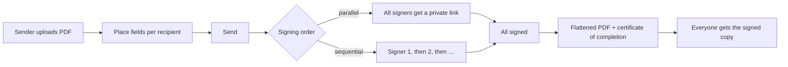

<div align="center">


# Countersign

**Open-source e-signatures you host yourself.**

Upload a PDF, place fields, send it to everyone who needs to sign, and get back a signed PDF with a certificate of completion and a full audit trail.<br>
No pricing. No seats. Your documents never leave your server.

[](LICENSE)


[Quick start](#quick-start) · [Features](#features) · [Configuration](#configuration) · [Security](#security-model) · [Contributing](#contributing)

<br>


</div>

---

## Why Countersign

Most teams only need the core of an e-signature product: send a PDF, collect signatures in the right order, and keep proof of who signed what and when. Countersign gives you exactly that as one small, self-hosted service.

| | |
|---|---|
| **Own the data** | PDFs, signatures and audit logs live in one volume on your server. Nothing is sent to a third party. |
| **One command to run** | A single Docker container with a built-in SQLite database. No database server, queue or object storage. |
| **Free means free** | No plans, no per-envelope limits, no locked features. |
| **Signers need nothing** | Recipients open a private link and sign in the browser on any device. No account, no download. |

## Features

<table>
<tr>
<td width="50%" valign="top">

### Prepare
Upload any PDF and click to place **signature, initials, date signed, full name, email, text and checkbox** fields. Drag to move, resize from the corner, nudge with the arrow keys. Each recipient gets their own colour.

### Route
Any number of signers, plus people who only receive a copy. Sign **in parallel or in a set order**; the next person is notified the moment the previous one finishes. Add a message and automatic email reminders.

### Templates
Save a document with fields placed for roles like *Client* and *Agency*. Reuse it and only type names and emails.

</td>
<td width="50%" valign="top">

### Sign
A guided walkthrough jumps from field to field. Signers **type or draw** a signature once and reuse it everywhere. Works with a mouse, trackpad, finger or keyboard, and on small phones.

### Finish
When the last person signs, every field is flattened into the PDF and a **certificate of completion** is appended: signers, timestamps, IP addresses, the original file's SHA-256 and the full audit trail.

### Manage
A dashboard with *Needs your signature*, *Waiting for others*, *Completed* and *Drafts*. Copy signing links, send reminders, let signers decline with a reason, and void a document at any time.

</td>
</tr>
</table>

## Screenshots

<table>
<tr>
<td><p align="center"><sub>Documents dashboard</sub></p></td>
<td><p align="center"><sub>Placing fields for each signer</sub></p></td>
</tr>
<tr>
<td><p align="center"><sub>Signer view, no account needed</sub></p></td>
<td><p align="center"><sub>Certificate of completion in the signed PDF</sub></p></td>
</tr>
</table>

## Quick start

### Docker (recommended)

```bash
git clone https://github.com/cre8ive-marketing/Countersign.git
cd Countersign
cp .env.example .env      # set APP_URL; SMTP is optional
docker compose up -d
```

Open `http://localhost:3000` and create the first account. Sign-ups close after that unless `ALLOW_SIGNUP=true`.

All state lives in the `countersign-data` volume (`/data` in the container): `countersign.db` (SQLite) and `files/` (original and signed PDFs).

### Without Docker

Needs **Node.js 22.13 or newer** (it uses the built-in `node:sqlite`).

```bash
npm ci
npm run build
npm start
```

Data goes to `./data` unless `DATA_DIR` is set.

## Configuration

| Variable | Default | What it does |
|---|---|---|
| `APP_URL` | request host | Public URL used in emailed links, reminders, `robots.txt` and `sitemap.xml`. `https://` turns on Secure cookies. Required for automatic reminders. |
| `DATA_DIR` | `./data` (`/data` in Docker) | Where the database and PDFs are stored. |
| `ALLOW_SIGNUP` | `false` | The first account can always sign up. Set `true` to let anyone create an account. |
| `TRUST_PROXY` | `false` | Set `true` behind a reverse proxy so the audit trail records the client IP from `X-Forwarded-For`. |
| `SMTP_HOST` `SMTP_PORT` `SMTP_SECURE` `SMTP_USER` `SMTP_PASS` `SMTP_FROM` | unset | Email delivery. Without SMTP, senders copy each signing link from the document page. **Set `APP_URL` too:** emails are not sent without it, because links built from the request's host could be forged. |
| `PORT` | `3000` | HTTP port. |

## Operating it

- **HTTPS:** run it behind Caddy, nginx or Traefik, set `APP_URL=https://…` and `TRUST_PROXY=true`, and add HSTS at the proxy. Forwarded headers are ignored unless `TRUST_PROXY=true`. If your proxy rewrites the `Host` header and you leave it off, form submissions are rejected as cross-origin.
- **Backups:** stop the container (or use `sqlite3 .backup`) and copy the whole data volume. The database and `files/` must be backed up together.
- **Upgrades:** `git pull && docker compose up -d --build`. The schema is created and extended on start.

## How it works



| Layer | Technology |
|---|---|
| App | Next.js (Pages Router), React, plain JavaScript |
| Data | SQLite via Node's built-in `node:sqlite`, PDFs on local disk |
| PDF | `pdf-lib` for stamping and certificates, `pdfjs-dist` for in-browser rendering |
| Email | Optional SMTP through `nodemailer`; hourly reminder job |
| Deploy | One Docker image (Next standalone, non-root) with one data volume |

## Security model

- Passwords are hashed with scrypt. Sessions are opaque `HttpOnly; SameSite=Lax` cookies, `Secure` on https.
- Every state-changing request is checked for same origin. Every document read or write checks ownership on the server.
- Signers use an unguessable per-recipient link. They can only see their own fields, and only when it is their turn.
- The original PDF is never modified. The signed copy is a separate file, and both SHA-256 hashes are recorded.
- Every action (upload, send, email, view, sign, decline, void, reminder) is written to the audit trail with time, IP and browser.

**Known limits**
- These are electronic signatures with an audit trail. They are not certificate-based digital signatures (no PAdES/X.509 seal). Check what your documents and jurisdiction require. Countersign makes no compliance or legal-validity claims.
- Signing links do not expire yet, and login is not rate-limited. Put the service behind your own proxy if it faces the internet.
- Text typed into fields supports Latin-1 characters only (Devanagari or CJK print as `?`). Signatures are images and are not affected.
- Not built yet: bulk send, teams and roles, a REST API and webhooks, custom branding, signing-link expiry, SSO.

Found a vulnerability? Please report it privately to the maintainers instead of opening a public issue.

## Development

```bash
npm install
npm run dev                               # http://localhost:3000
node scripts/sample-pdf.mjs sample.pdf    # a two-page NDA to try the editor with
```

`npm test` runs the end-to-end signing flow over HTTP against a running server. Point `BASE_URL` at it (default `http://localhost:3000`) and start that server with `ALLOW_SIGNUP=true` and a throwaway `DATA_DIR`.

```
pages/            UI routes and API routes (pages/api)
components/       React components (app shell, PDF viewer, signature pad, marketing)
lib/              database, auth, HTTP helpers, signing engine, PDF stamping, email
styles/           one global stylesheet with design tokens
test/             end-to-end tests
```

## Contributing

Contributions are welcome.

1. Open an issue describing the bug or feature before large changes.
2. Keep changes small and focused. Follow the existing structure, with no new frameworks or databases.
3. Run `npm run build` and `npm test` against a disposable server before opening a pull request.
4. New behaviour needs a test. Security-relevant changes (auth, links, uploads, audit trail) need a short note on what you checked.

The design system is documented in [`DESIGN.md`](DESIGN.md). Product scope and principles are in [`PRODUCT.md`](PRODUCT.md).

## License

Countersign is free software under the [GNU Affero General Public License v3.0](LICENSE). You can use, modify and self-host it, including commercially. If you run a modified version as a network service, you must offer its source code to the people who use it.

<div align="center"><sub>Countersign is an independent project and is not affiliated with DocuSign, Inc.</sub></div>
